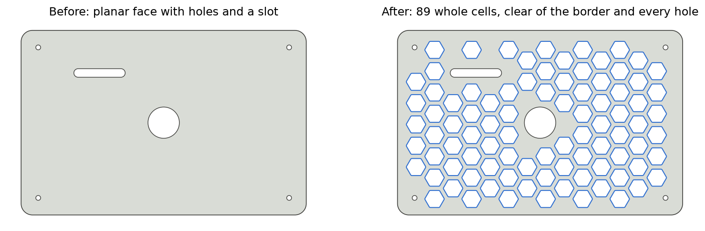
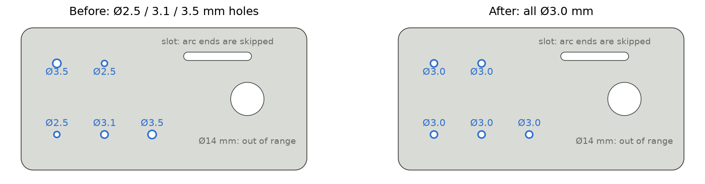

# Scripts do Fusion 360 para chapas mais leves

**Colmeia de alívio e padronização de furos para chapas cortadas a laser ou impressas em 3D, num clique.**

Dois scripts em Python para o Autodesk Fusion 360 que agilizam o projeto de chapas como as do chassi de um robô. Cada um roda em segundos e é desfeito com um único Ctrl+Z. A interface dos scripts é em inglês.

| Script | O que faz |
| --- | --- |
| [HoneycombLightening](#honeycomblightening) | Recorta uma colmeia de alívio numa face plana, mantendo uma borda sólida e uma margem em volta de cada furo |
| [StandardizeHoles](#standardizeholes) | Muda para um único diâmetro todos os furos de uma faixa, no corpo ou num sketch |

[Read in English](README.md)

## Instalação

1. Baixe este repositório (botão verde **Code** → **Download ZIP**) ou clone.
2. No Fusion 360: **Utilitários → Suplementos → Scripts e suplementos** (Shift+S).
3. Clique no **+** ao lado de *Meus scripts* → **Script ou suplemento do dispositivo** e escolha a pasta do script (`HoneycombLightening` ou `StandardizeHoles`).
4. Selecione o script e clique em **Executar**.

Cada script roda como um comando normal do Fusion: um **Ctrl+Z** desfaz tudo o que ele fez.

## HoneycombLightening

Selecione a face de cima da placa e o script recorta os hexágonos:

- **Só hexágonos inteiros:** nenhum é cortado pela borda ou por um furo.
- **Borda sólida** no contorno e **margem sólida** em volta de cada furo, rasgo ou recorte que já existe.
- **Cantos arredondados** em todos os hexágonos (linhas e arcos de verdade no sketch).
- **Posição otimizada:** testa 16 posições da malha e fica com a que encaixa mais hexágonos.
- Cria um sketch chamado *Honeycomb lightening* e um único corte por extrusão, limitado ao corpo da placa. Nenhum outro corpo é cortado.
- Mostra quantos hexágonos recortou e quanto do volume da placa foi removido.

| Parâmetro | Padrão | Observação |
| --- | --- | --- |
| Hexagon (across flats) | 12 mm | Tamanho do hexágono, medido entre faces paralelas |
| Rib width | 3 mm | Nervura entre hexágonos vizinhos |
| Solid border | 5 mm | Faixa sólida na borda externa |
| Margin around holes | 4 mm | Faixa sólida em volta de cada furo, rasgo e recorte |
| Corner radius | 1 mm | 0 deixa os cantos vivos |
| Pattern rotation | 0° | Só importa de 0° a 60°; 30° deixa os hexágonos "de pé" |
| Optimize position | ligado | Desligado = malha ancorada no canto da face |

Valores de partida que já usamos:

| Processo | Hexágono | Nervura | Borda | Margem |
| --- | --- | --- | --- | --- |
| Impressão FDM, 3 mm em PETG/PLA | 9–12 mm | 2,5–3 mm (≥ 6 larguras de linha) | 4–5 mm | 3–4 mm |
| Acrílico de 3 mm a laser | 15–18 mm | 5 mm | 8–12 mm | 6 mm |

O acrílico é rígido, mas quebradiço: use nervuras e bordas mais largas e raio de canto de 2 mm ou mais.

## StandardizeHoles

Selecione um **corpo** (recomendado) ou um **sketch**, defina a faixa de diâmetros e o diâmetro novo.

- **Corpo:** acha as faces cilíndricas dos furos dentro da faixa e cria um *Deslocar face* por tamanho de furo. Funciona venha o furo de onde vier: sketch, comando Furo, DXF ou STEP importado. Fecha ou abre furos.
- **Sketch:** muda os círculos desenhados naquele sketch, pela cota quando houver.
- **Fica de fora de propósito:** pontas de rasgo (arcos, não círculos inteiros), pinos e standoffs (cilindros por fora), círculos projetados e tudo o que estiver fora da faixa.
- **Count only** mostra o que seria alterado, sem alterar nada.

| Parâmetro | Padrão | Observação |
| --- | --- | --- |
| Minimum diameter (above) | 3 mm | A faixa não inclui este valor |
| Maximum diameter (up to) | 4 mm | A faixa inclui este valor |
| New diameter | 3 mm | Diâmetro final de todos os furos encontrados |
| Count only | desligado | Só conta, não altera |

Exemplo: para levar furos de 2,5 mm a 3,0 mm, use mínimo 2,4, máximo 2,9 e novo 3,0.

Um círculo **projetado** num sketch novo é só uma referência da aresta: mudar ele não muda a peça. Selecione o corpo.

## Dicas para corte a laser

- O laser CO₂ remove uns 0,1–0,25 mm (o kerf), então o furo sai um pouco **maior** que o desenho. Para parafuso M3, um furo desenhado com 3,0 mm costuma sair com 3,1–3,2 mm.
- Corte uma plaquinha de teste com furos de 2,8 a 3,3 mm antes da peça: o kerf muda com a máquina e o material.
- Se a rosca está em pilares de metal, a chapa só precisa de furo passante. Não rosqueie acrílico: ele trinca.
- Não use trava-rosca líquido perto de acrílico: ele ataca o plástico e causa trincas. Use porca com anel de nylon e arruela.

## Observações

- Testado no Fusion 360 para Windows (outubro de 2026). As unidades são milímetros.

## Como contribuir

Relatos de bug, ideias e pull requests são bem-vindos. Se um script falhar numa peça sua, abra uma issue com um print da face que você selecionou e a mensagem de erro.

Se os scripts te pouparam tempo, uma ⭐ ajuda outras pessoas a encontrarem o projeto.

## Licença

[MIT](LICENSE) © 2026 Isxqwe

Feito com a ajuda do Claude (Anthropic).
